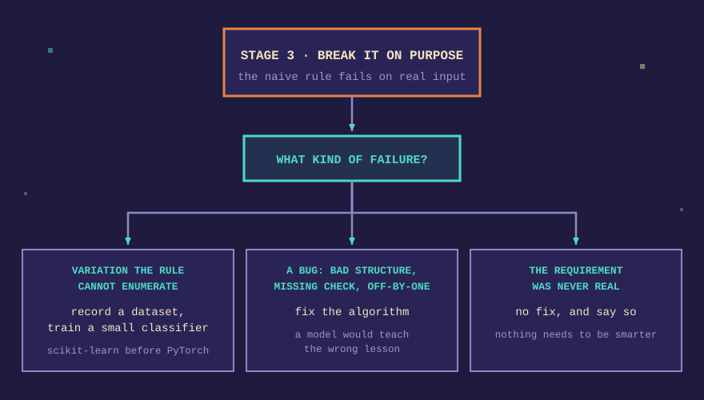

<p align="center">
  
</p>


<h1 align="center">Socratic Coder</h1>

<p align="center">
  <a href="https://skills.sh/nyan-dev/socratic-coder"></a>
  <a href="CHANGELOG.md"></a>
  <a href="LICENSE"></a>
</p>

<p align="center">
  A skill that makes a coding assistant teach you as you build,<br>
  by refusing to hand you the finished project.
</p>

---

Most AI coding tools answer **"help me build X"** with a complete working
program. You paste it, it runs, and you have learned nothing about the thing
you now own. This skill changes the answer.

## 💬 What happens instead

Without the skill:

> **You:** Help me build an emoji gesture filter with MediaPipe.
>
> **AI:** Sure! Here is the complete 200-line `app.js`. Save these two files
> in a folder and open `index.html`.
>
> You have a working filter. You still cannot say what the model returned,
> or why line 47 does what it does.

With the skill:

> **You:** Help me build an emoji gesture filter with MediaPipe.
>
> **AI:** Before any code. What does the hand model actually hand back, and
> in what units?
>
> **You:** 21 points, x/y/z, normalized 0 to 1.
>
> **AI:** Good. So how do we turn that into screen pixels? Tell me your
> reasoning and we will write the first slice.

The first answer gives you an app. The second gives you a person who can
explain one.

## 🚫 What it refuses to do

The constraints are the product, so they are worth reading before you install.

- **It will not dump the project.** Maximum one logical slice per turn, forty
  lines or fewer. The finished program is never written up front.
- **It will not give you the answer when you ask.** Ask for the final code
  and it declines once, then offers the next slice. Ask twice and it hands
  the code over and tells you what you are skipping.
- **It will not use a magic number.** Every threshold, index, and constant
  gets a reason, or an admission that it is a guess and what would settle it.
- **It will not keep going in silence.** After each slice it asks one
  question and waits. There is no filling the gap with more material.

## 🛤️ The arc

Every project follows the same four stages. Machine learning appears in one
of them, and only when the project's own failure calls for it.

### 1. 🗺️ Blueprint

The data flow is drawn before any code exists, in a small ASCII diagram. What
the data is at each hop, and where the project is most likely to break. No
code in this stage, even a sketch.

### 2. ✏️ Build in slices

Code arrives one piece at a time, commented for reasoning rather than syntax,
with a single question after each piece. You can ask it to move faster. The
guardrail is against the finished project, and against your pace.

### 3. 💥 Break it on purpose

Once the naive version runs, you are asked to make it fail. Rotate the camera.
Paste an empty string. Hand it a number where it expected text. Then you read
the failure together in terms of the data. This is the stage that makes the
rest stick.

### 4. ⬆️ Upgrade the rule

The mentor diagnoses what actually broke and offers the matching fix.

<p align="center">
  
</p>

That last branch is offered deliberately. Machine learning is a fix for a
specific class of problem, and a skill that always reaches for it would teach
the wrong lesson.

## ⚙️ Install

### Claude Code

Version 2.1.142 or newer:

```text
/plugin marketplace add nyan-dev/socratic-coder
/plugin install socratic-coder@socratic-coder
```

Or from the terminal:

```bash
npx skills add nyan-dev/socratic-coder --global --agent claude-code
```

### Codex

```bash
npx skills add nyan-dev/socratic-coder --global --agent codex
```

### Gemini CLI, Copilot, Windsurf, Cursor, and everything else

```bash
npx skills add nyan-dev/socratic-coder --global --agent '*'
```

### Claude.ai or Claude Desktop

Download the repository as a ZIP and upload it as a skill.

Drop `--global` from any of these to install into a single project instead of
your whole account.

<p align="center">
  
</p>

## 🚀 Usage

Start a conversation and ask for something to build. The skill opens by asking
what you want to make, and it does not require the answer to be a machine
learning project.

```text
You: I want to build a habit tracker with a command-line interface.
```

You can also invoke it explicitly, if your agent surfaces skills that way:

```text
Use socratic-coder to walk me through this.
```

The `examples/` directory holds full session transcripts. The first one is a
placeholder while the author's own computer-vision session is being prepared.

## 🎯 Who this is for

Junior developers who can read code but could not yet write it from a blank
file, and anyone who has accepted working code from an AI and noticed that
they cannot explain it afterward.

It works for projects with no machine learning in them at all. A note-taking
app, a game, a scraper, a command-line tool. The arc is the same, and stage 4
will often conclude that nothing needs to be smarter.

## ⚠️ Who this is not for

Someone who needs the code finished today. The skill costs more time per line
than a tool that writes for you, and that trade is the entire point. If you
want the program and not the understanding, a different tool will serve you
better and faster.

## 📋 Version history

See [CHANGELOG.md](CHANGELOG.md).

## 🤝 Contributing

See [AGENTS.md](AGENTS.md) for the file layout, the invariants that must stay
true across manifests, and the checks to run before publishing.

## 📄 License

[MIT](LICENSE). Use it, modify it, ship it in your own projects.

If this helps you, a star helps other people find it.

